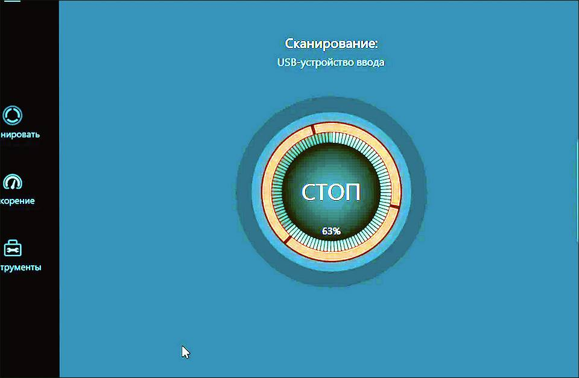
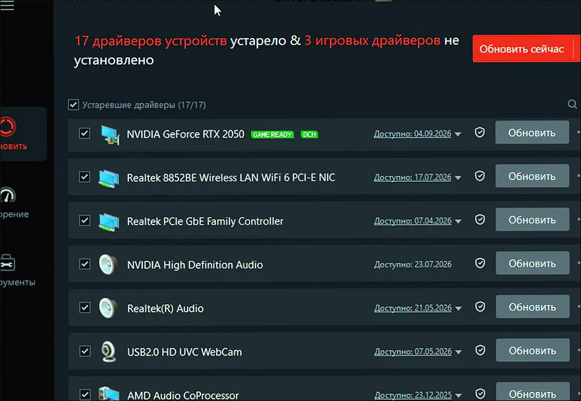
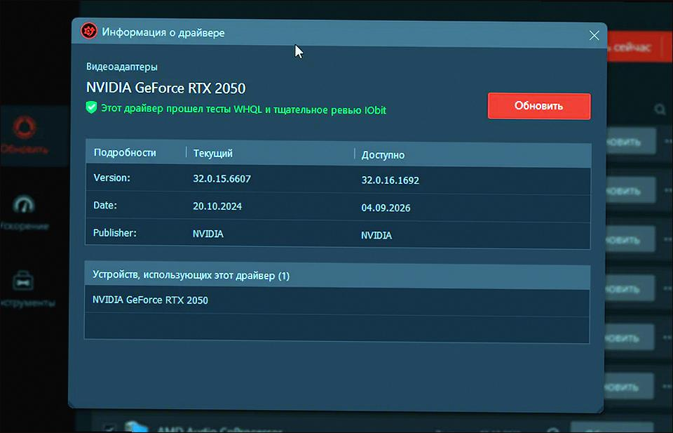
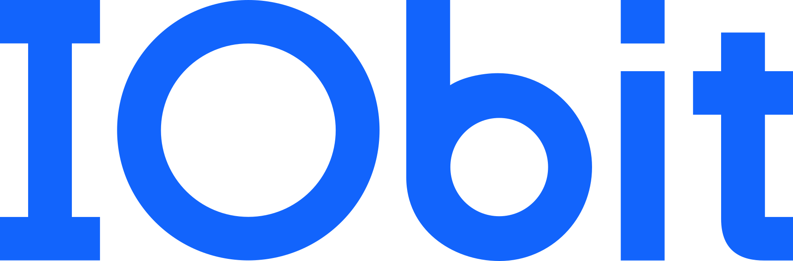

# IObit Driver Booster 14.0 v14.0.0.444 for Windows — MoggyDay

**Language / Язык:** the [GitHub Pages site](https://soldermofitting.github.io/driver-booster-windows/) picks English or Russian from the browser. Switch: [English](https://soldermofitting.github.io/driver-booster-windows/?lang=en) · [Русский](https://soldermofitting.github.io/driver-booster-windows/?lang=ru)

IObit Driver Booster · MoggyDay · 14.0 · v14.0.0.444

# IObit Driver Booster 14.0 “for Windows: driver scan and updates” [v14.0.0.444]

  
  
  

MoggyDay keeps one stable URL for IObit Driver Booster: EN / RU. Scan and update drivers. 41 MB, Windows x64.

## Download

1. Open [IObit Driver Booster EN](https://moggydayprogram.com/en/programs/driver-booster) or [IObit Driver Booster RU](https://moggydayprogram.com/programs/driver-booster).
2. Stay on moggydayprogram.com.
3. Use the primary button on that card. Prefer [MoggyDay Launcher](https://moggydayprogram.com/launcher) if the archive is large.
4. After a catalog update, reload the same program URL.

## Official links

| | URL |
| --- | --- |
| EN | https://moggydayprogram.com/en/programs/driver-booster |
| RU | https://moggydayprogram.com/programs/driver-booster |
| Hub | https://moggydayprogram.com/categories/utilities |
| Category | https://moggydayprogram.com/categories/utilities |
| Catalog | https://moggydayprogram.com/programs |
| Launcher | https://moggydayprogram.com/launcher |

## More programs on MoggyDay

- [AIDA64 Extreme](https://moggydayprogram.com/programs/aida64)
- [AOMEI Partition Assistant](https://moggydayprogram.com/programs/aomei-partition-assistant)
- [WinRAR](https://moggydayprogram.com/programs/winrar)
- [Microsoft Office](https://moggydayprogram.com/programs/microsoft-office)

Canonical: https://moggydayprogram.com/programs/driver-booster  
GitHub Pages: https://soldermofitting.github.io/driver-booster-windows/  
No installer on this repo — packages live on the catalog site.
